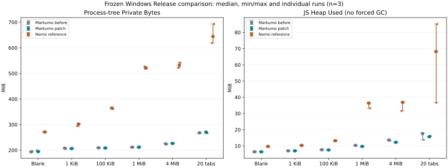
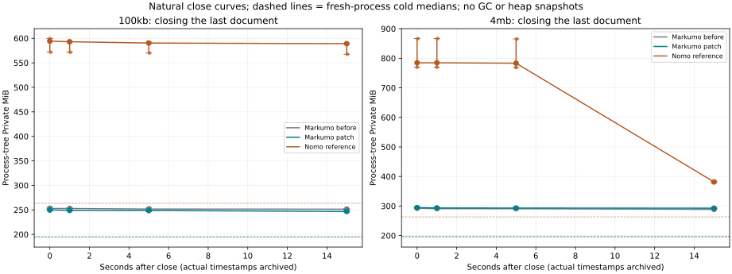

# P0.3 普通文本与分段架构调查（分阶段验收）

本报告随验证更新；未通过的阶段不进入默认打开路径。调查阶段未修改版本号、推送、Tag 或发布 Release；后续 v1.1.3 发布按用户另行授权进行。

## 源码与测量边界

- Markumo：2026-10-29 fetch 后的测量基线 `main` / `origin/main` = `4a94f0b`，版本 1.1.2。全部修改在 main。测量冻结后 main 又加入 `47322e3`、`1eff04d` 的 Markdown 输入修复；冻结矩阵不能当成这两个后续提交的实测数据。
- Nomo：2026-10-29 shallow clone 默认分支 `339fb932db064508af4e471a0fda8f44468d0157`，版本 0.6.2；参考副本位于忽略的 `test-results/p03/nomo`，不在参考仓库修改源文件。
- 两库 LICENSE/package 清单分别声明 AGPL-3.0-only / AGPL-3.0-or-later。下述架构分析注明来源；Markumo 新实现独立编写，不移植 Nomo 源码。Nomo 原作者与原仓库见 [nomo-md/nomo](https://github.com/nomo-md/nomo/tree/339fb932db064508af4e471a0fda8f44468d0157)。
- Windows Release 原始测量必须使用独立 Profile、独立 WebView UDF、同 Runtime 和 1200×780 窗口，每场景三次；自然曲线不执行 GC。任务管理器的内存列不能与 Private Bytes 混用。进程树按 Rust PID 的祖先关系和创建时间过滤。
- 使用最小 CDP（Page / Runtime / Performance），不启用 Network / Debugger。P0.1 已证明自动化工具的响应缓存与 heap snapshot 会改变被测进程，侵入式诊断另起进程。

## 阶段 1/2：实际源码比较与瓶颈证据

| 项目 | Markumo 原路径 | Nomo 当前路径 |
|---|---|---|
| 路由 | `files/mod.rs::read_selected` 将普通文本完整解码为 String，通过 IPC 给 `DocumentManager.create`；原上限 16 MiB | `documentRouter.ts::openDocumentByPath` 按扩展名将 Markdown / TXT、JSON 分开，TXT/JSON 无论大小都走 segmented port；不直接覆盖 Markumo 的其他格式 |
| 规范所有者 | 每文档一个持久化 CM EditorState/Text，baseline 初始与 doc 同一引用；分栏共享规范 Text，选区分别存放 | `session.rs` 中 Rust revision + piece tree；CM 只持有当前窗口，本地乐观编辑经 edit batcher 确认 |
| 后台标签 | `showActive` 每可见分栏一个 EditorView，`setState` 换标签；后台保留 State、历史和选区，无每标签 DOM | App 切换前 flush segmented edits，再销毁/创建 Core；Rust session 留存 |
| 语言加载 | JSON/Java/SQL/XML 等 loader 已用动态 import；native.ts 内部也逐语言动态 import。原 registry 顶层导入 semantics 的边已移入 Markdown loader；formatCommands 仍静态依赖 Lezer Markdown，因此不能宣称整个 Markdown 模块已从首屏移除 | 分段 TXT 不加载整文语法；JSON 有携带 lexical checkpoint 的窗口 lexer，超 100,000 字节长行另有保护 |
| Markdown 专属状态 | 原来所有普通文本也安装 imageImportBookmarks、MarkdownResources（含 allowedRemote 集合、资源闭包）；只有 slash 已按 Markdown 条件安装 | segmented Core 与 PM Markdown Core 分离 |
| 换行 | 原 `lineEndings.ts` 为每一个 LF/CRLF/CR 建立 Break 对象、Range 和 RangeSet；serialize 建每行两项 parts，即使全是 LF | canonical storage 保留 UTF-8 字节；窗口 mapping 处理 CM 的规范化换行；行索引追踪 previous_cr，避免跨块 CRLF 双计数 |
| 保存/历史 | `saveSnapshot` 生成完整串；Tauri native 已事务化历史，但 FileController 在分支判断前仍 `getBaselineText`；额外的 baseline 全文串无用途 | frozen revision 流式写临时文件、同步、外部 baseline 再校验、原子替换；保存期间更高 revision 通过 journal 重放，dirty 不误清 |
| Rust 原始数据 | `read_disk` Vec + codec String + IPC 序列化峰值；服务 Grant 不常驻整份正文；不能把这些瞬时分配都算成泄漏 | `chunk_reader.rs` OriginalFile 绑定句柄，后台建立不可变 baseline（COW clone / 流式 copy）；AddedStore 在磁盘追加，不是无限 JS 字符串 |
| 大文件定位 | 全文 CM Text 的行树，完整文档驻留 JS | `piece_tree.rs` 持久化隐式 Treap，按逻辑长度期望 O(log n) 定位；原始段/新增段引用 offset/length。`line_index.rs` 256 KiB 扫描、约 1 MiB 稀疏检查点，不为每行存一个 offset |
| 滚动 | CM 全文高度图/viewport | `virtualScroll.ts` 冻结字节→像素比例，轨道上限 16,000,000px；正式窗 512 KiB，快速预览 16–64 KiB、50ms 节流、100ms 停止扩展。字节进度轨道不是精确全文行高 |
| 缓存/乱序 | CM state 本身不是可随意淘汰的缓存；历史不应削掉 | `viewportController.ts` revision + requestId 防乱序；主窗、选择和预取 pin；销毁取消结果并清 LRU。`chunkCache.ts` 容量按 bytes 及 number[] 映射成本估算，pin 可短暂超容量；Rust chunk cache 默认 8 MiB |
| 搜索/替换/恢复 | 搜索在 CM Text 上；恢复以 immutable Text identity 去抖，非每键 serialize | `task_runner.rs` 64 KiB 流式任务、取消 flag、结果页限制；替换生成文件并在 revision 校验后提交。session/journal 持有恢复 baseline，外部变化不直接套 patch |

不能直接照搬的取舍：Nomo 当前编码枚举为 UTF-8 / UTF-8 BOM / unsupported；Markumo 已有 UTF-16LE/BE、GB18030、windows-1252、Hex、原始字节保存与文件身份保证。Nomo 的历史容量策略也不能用来裁剪 Markumo 用户历史。分段化不能只把 CM 的全文替换为一页而继续沿用普通保存/复制/搜索接口。

### 已实施的普通文本改动

1. Markdown 专属资源与导入状态放入独立 compartment，仅 Markdown 文档安装；TXT ↔ MD 另存为时重配，保留原有内容与历史。
2. language registry 将 Markdown semantics 的导入移入 Markdown loader；不修改普通代码语言的按需加载与高亮功能。
3. 原生事务历史路径不再生成无用途的 baseline 字符串；浏览器非事务历史路径仍在写盘前归档。
4. 统一 LF/CRLF/CR 文件的换行表为零条目，新插入换行继承既有默认策略。混合文件保留原来的有序标记，以保持删除边界处碰撞标记的优先级；Undo 的 inverted effect 仍恢复原表。序列化只在非默认换行处拼接连续跨度，避免每行两项临时数组。
5. `formatCommands` 的 Markdown fallback parser 配置、大纲的两个 MarkdownIt 实例延迟到首次使用。基础模块仍可能随首屏代码加载，这项变更只消除提前创建的实例，不代表所有 Markdown 代码已按需分包。
6. `getTextDocument` 暴露 FullTextDocument 的只读 Text 快照；新协议用 UTF-16/UTF-8 单位区分两条存储路径。小文件仍同步输入，不增加逐键 Rust IPC。

未改动普通输入的 IPC、CM Undo/Redo、规范 Text/baseline 的共享关系、后台标签状态持有策略。每份文件只有一个 canonical record / history；各分栏有自己的 EditorState 和选区，变更后的 Text 根不保证对象身份相同，但共享持久化子树，不能按根数量当作全文副本数。`useAppShell` 仍装配文件/恢复/工作区和一个轻量图片导入协调器；TXT/LOG 不安装文档级图片资源、导入书签、PM、SourceBridge 或预览。首屏代码与常驻功能尚未完全拆分。

全文路径的临时所有权仍需明确：`read_disk` 读取 Vec，`codec::decode_with_path(&bytes)` 的严格 UTF-8 Cow 经 `into_owned()` 形成独立正文 String，返回前两份完整正文缓冲可能同时存活；legacy 编码还会为严格回编码校验分配。随后 Tauri JSON/IPC 与 JS 字符串、CM 分片有各自峰值，ASCII 字符串不能一律按 UTF-16 两字节估算。保存仍需一个完整序列化正文、IPC 和 Rust 编码 Vec；没有在本轮偷偷用逐键 Rust IPC 替代小文件路径，也没有声称消灭所有全文复制。Tauri 内部的确切临时复制次数没有 allocation 调用栈证据，不能仅按源码估成一个固定倍数。

`RecoveryController` 观察 immutable Text 身份并去抖，实际快照时才 `Text.toString()`，之后 `TextEncoder` 校验预算仍有瞬时分配；不是每次按键就复制全文。搜索主路径继续直接使用 CM Text，历史正文和差异查看本身仍可能构建整串/行数组。这些已有数据保护能力保持，不能为了降低峰值删除恢复或历史；将来接入大文件时需要独立流式协议，不能沿用这些 FullText 保存/复制入口。

### 堆快照证据与解释边界

在独立 Windows Release 诊断进程中，对 4 MiB TXT 采集 cold / loaded / closed 快照。旧版有一个文件 Seed，经 `DocumentManager.records → EditorState.config → 扩展 create 闭包 → Context → seed` 保留；新版为零。Seed 原浅大小 44 B，离线支配树估算其独占 retained 476 B；其 text 指向 4,194,316 B 的字符串，但该串同时被 CM 文本切片共享。两版均仍保留该字符串，**不能宣称删除 Seed 就释放 4 MiB**。

两版 loaded 都有 2 个 CM EditorState、1 个可见 EditorView，当前 Text 树只有 1 个根、546 个节点（33 个分支）。关闭并诊断 GC 后，两版 CM State / View / 文件字符串均归零。Vue effect 结构匹配数均为 166 → 184 → 166；强可达 detached 节点均为 2 → 2 → 2。该样本没有证明原有文档关闭泄漏，也不能证明无限循环已平台化。

离线强引用图 self_size 合计（包括相关原生 DOM 节点）为：旧版 loaded 16,961,281 B，新版 16,626,805 B；closed 10,613,239 / 10,584,623 B。这里只是单次诊断，不能代替三轮自然内存对比。分析排除 weak / 非根 shortcut / ephemeron part-of-key 边，没有实现 DevTools 的所有 page-owned 标记，retained 字段标记为估算，不能与进程 Private Bytes 相加。快照会先触发 GC，也会增加 profiler 原生分配，原生性能数字只取独立自然进程。[Chrome 快照说明](https://developer.chrome.com/docs/devtools/memory-problems/heap-snapshots/)、[Edge 格式定义](https://learn.microsoft.com/en-us/microsoft-edge/devtools/memory-problems/heap-snapshot-schema)。

Nomo 100 MiB TXT 的独立快照中，当前 CM 树 1 个根 / 98 个节点，发现的最大 fixture 字符串 self_size 为 524,300 B；关闭后 CM State / View 和 fixture 字符串归零。detached 结构计数 28 → 63 → 63，本轮未逐个归因或做其长期增长分析，不能直接称为泄漏或已消除泄漏。Vue 结构匹配规则不适用于 Svelte。

## 阶段 3：独立 Rust 原型

`src-tauri/src/text_document/` 由 `segmented-prototype` feature 隔离；默认不编译，没有注册 Tauri IPC，也没有修改原来的文件路由或 16 MiB / 200,001 行安全限制。

- `pieces.rs`：独立实现持久化 AVL 序列，叶片只含 Base / Added 磁盘区间。编辑 split / join，Undo/Redo 保存共享根；选 AVL 是为了确定的平衡界限，未复制 Nomo 的 Treap 实现。
- `mod.rs`：建立不可变私有基线，严格校验 UTF-8/BOM；新增数据追加到磁盘。读取最多 256 KiB；流式 I/O 缓冲 64 KiB；每批插入最多 1 MiB。窗口不切开 UTF-8 标量或 CRLF。
- `line_index.rs`：最多约 2,048 个稀疏检查点，不为每一行建索引；全局字节、逻辑行和 UTF-16 列映射保留 CRLF 状态。首次定位全量扫描，编辑/Undo 后按需重建。
- `search.rs`：有界 KMP 字面搜索，结果最多 1,024 项；替换流式生成临时文件后追加到 Added，以单个根提交，支持整个操作 Undo。查询最多 64 KiB，替换字符串最多 1 MiB；输出允许最多增长 512 MiB，并受 8 倍或至少 1 MiB 的结果预算约束，超预算拒绝，不提交部分结果。
- 取消按块传播，临时文件由 RAII 释放。真实后台取消测试发现 `Interrupted` 会被 `write_all` 重试，已改为不可重试的取消错误并验证无部分提交、无残留任务文件。[Rust Write 契约](https://doc.rust-lang.org/std/io/trait.Write.html#method.write_all)。
- `save_copy` 只流式创建新文件，不覆盖已有文件；版本不匹配拒绝操作。原文件外部变化不污染私有基线，可以单独检测，不能绕过稳定路径覆盖原文件。
- checkpoint 同步数据后原子保存根描述及散列，恢复验证基线和已提交 Added 前缀；未 checkpoint 的尾部不会污染最近恢复点。保存全部 Undo/Redo，未裁剪历史；显式 discard 才删除会话资产，普通 close 保留恢复点。

### 原型尚未达到产品验收的原因

1. 只支持 UTF-8/BOM。UTF-16、GB18030、windows-1252、Hex 继续走原稳定路径；大型这些编码尚无可用产品路径。
2. 保存副本通过，但未实现 Markumo 的原文件 Windows identity/ACL 保留、事务历史、外部冲突交互和跨窗口授权。不能把 CLI 的路径参数直接发布为无授权 Tauri 命令。
3. 当前 checkpoint 展平所有历史根描述，长历史有二次增长风险，8 MiB 元数据预算会明确拒绝 checkpoint，保持当前文本与历史。需要真正的增量 journal / 持久化根方案，不能通过裁剪撤销来解决。
4. 打开会流式扫描/复制整个原文件以完成严格验证和不可变基线，内存有界，但时延和磁盘量仍随文件大小增长。尚未实现首屏先返回、后台验证/基线的完整安全协议。
5. UTF-8 字面搜索/替换通过；正则、全词、不区分大小写、多窗口广播及任务 UI 仍未全部接入。

这些是默认路由的硬门槛，不能以能滚动、构建通过或 CLI 内存较小代替完整验收。

## 阶段 4：CodeMirror 窗口实验

`src/editor/text/` 是独立实验适配器，不被正常 EditorContainer 加载。`WindowMap` 使用 Uint32Array 映射局部 UTF-16 / CRLF 与全局 UTF-8；64 KiB 正式窗口、256 KiB 最大窗口、1 MiB 待确认编辑预算，未设置无限预取/LRU。`SegmentedWindowEditor` 提交增量、串行确认、保留失败队列，窗口切换前 flush，组合输入期间不换窗。历史属于 Rust；流式替换后重读有界窗口。关闭成功后清除局部投影并销毁 DOM，canonical 内容/历史由恢复点保留。

`SegmentedScrollRail` 使用有上限的字节进度轨道，80 ms 合并滚动请求；每次最多一个窗口请求在途，快速连续定位只保留最新目标。该轨道表达字节进度，不冒充精确全文行高。

真实联动测试通过 Node 的测试专用 HTTP bridge 调用 Release Rust CLI，再驱动真正的 CM。约 100 MiB 文件首窗不超过 65,536 字符；200 次快速 seek 的峰值并发读为 1；远处编辑、全文字面搜索/替换、完整文件 SHA-256、Undo/Redo、保存副本、关闭恢复通过。这是正确性实验，**不是 Windows WebView2 的分段产品性能数据**。

界面仍显示局部行号；全局行跳转 API 已实现，但跨窗选择、全选/全文复制、全局 Home/End/边界编辑、Undo 的选择/阅读锚点、完整语法高亮/补全、真实系统 IME 全流程、Workspace/Tab/多分栏/独立窗口/自动保存接入未全部完成。Mod-A 明确提示原型不支持，不能把局部窗口假装成全文。故不能替换稳定编辑器，也未设默认 1 MiB / 4 MiB 切换阈值。

## 测量与后续阶段

`scripts/p03-build-nomo.mjs` 通过 Vite transform 暴露 App 的普通打开/关闭/保存方法及当前 Core 的 WeakRef，不修改参考源码；原生构建使用独立 identifier。`scripts/p03-text-benchmark.mjs` 保存所有进程角色的 Private/Working Set、JS Heap、CM 常驻量、换行条目、打开/输入/保存时延、关闭曲线与二进制散列。瞬时峰值受采样周期限制，报告 observed peak 而非绝对分配峰值。

实际数据已归档为 [完整对照表](p03-release-tables-20261029.md)、[可复算结果](p03-release-results-20261029.json) 与 `p03-data-20261029/` 中的原始 gzip 数据。冻结主矩阵为 3 应用 × 13 场景 × 3 轮，共 117 个独立进程；不是 117 个功能全部通过。原始默认配置试跑因主题迁移、首次样例及更新检查不同，未混入本矩阵。

### 实测结果与结论

下表为自然 loaded 阶段进程树总 Private 的三轮中位数，单位 MiB。原版是 `4a94f0b` 原始源码，修复是同提交加本次普通文本修改；EXE 散列分别为 `a43a4664cb86…` / `a15821811498…`，完整身份及三次原值在对照表中。

| 场景 | Markumo 原版 | Markumo 修复 | Nomo 参考 |
|---|---:|---:|---:|
| 空白 | 193.55 | 194.52 | 271.15 |
| 1 KiB TXT | 207.58 | 206.60 | 302.04 |
| 100 KiB TXT | 209.31 | 208.76 | 364.61 |
| 1 MiB TXT | 211.94 | 211.93 | 520.69 |
| 4 MiB TXT | 224.28 | 226.57 | 532.02 |
| 20 × 100 KiB 标签 | 268.11 | 270.52 | 644.28 |
| 同文档四分栏 | 218.71 | 218.89 | 无等价分段分栏操作 |

**没有证据声称普通文本的进程总内存明显下降。** 这批数据中空白、4 MiB、20 标签中位数略高，小 TXT 基本持平；n=3 不能把所有微小差值都判为确定性能回退或提升。已确认消除的是多余状态及分配：4 MiB 统一 LF 文本的换行条目 16,384 → 0，JS Heap Used 中位数 13.60 → 12.23 MiB；20 标签 17.56 → 15.71 MiB。JS Used 受 GC 时机影响，保留大小的独立快照证据见上文，不能把这两个量混用。

普通输入（30 次中文/Emoji CM dispatch 到下一帧）每轮中位数再取三轮统计：1 KiB 为 5.50 → 5.60 ms，100 KiB 5.55 → 5.50 ms，1 MiB 均 5.50 ms，4 MiB 均 5.60 ms，四分栏均约 6.95 ms。该指标未发现普通输入的明显回退，但不是原生输入法候选 UI 延迟。100 KiB 打开中位数 73.49 → 63.86 ms，4 MiB 123.39 → 114.90 ms；不将单台设备 n=3 的差值宣传为普遍速度提升。

Nomo 的这份源码和探针在本机实测并不更轻；大文件窗口常驻机制仍值得参考。4 MiB TXT loaded 的 Browser / Renderer / GPU / Utility Private 中位数分别是 39.21 / 301.18 / 162.98 / 19.37 MiB；Markumo 修复是 39.33 / 70.09 / 88.62 / 19.23 MiB。各分项分别取中位数，不能要求分项中位数之和等于总量中位数。Nomo 窗口正文为 524,288 字节，4 MiB 与 100 MiB 并非各自全文进前端；这与其整个进程树是否轻量是两个问题。不能据此推断所有版本、机器和交互中的产品排名。

Nomo 100 MiB 原始三轮有两轮完成、一轮等待编辑解锁 60 秒超时；同一二进制独立补测又超时，即合计 4 次尝试只有 2 次完成。补测未改其源码，也未放宽只读校验；原因尚未确定，原始失败和补测均保留，不能报为三轮全部通过。表中该场景 loaded/编辑/保存的 n=2，cold 的 n=4，失败不能填成 0。Nomo `.log` 扩展名被拒绝；50 MiB TXT 的数据不冒充 50 MiB LOG。Markumo 50/100 MiB 及 50 MiB LOG 仍由原路径 16 MiB 上限拒绝；16 MiB 文件输入后超过上限，保存安全拒绝。10 MiB JSON 虽能打开和编辑，但原生历史的 8 MiB 备份预算导致保存拒绝。没有关闭历史来伪造保存通过，所有拒绝场景均验证原文件散列未变。

成功保存的场景已离线流式验证：原文件第 5 个 ASCII 字节处插入 30 份 UTF-8 `中😀` 后的独立期望 SHA256，与磁盘全部内容相同。拒绝及不支持的文件按原始 SHA256 验证。不能只用文件变大或 dirty=false 作为保存正确性证据。主矩阵共核验 108 份文件，加上失败补测及下述新 main 补充数据，合计 118 份。



### 关闭与原生高水位

4 MiB 文档完成编辑、搜索、保存并关闭，等待 15 秒后的进程树总 Private 中位数，原版 288.59 MiB，修复 292.71 MiB，均高于 loaded。此时规范 records / 可见编辑器归零；独立堆快照的诊断 GC 也证明 CM 与文件正文能释放。自然进程没有被强制 GC，不能把其 JS Used 的残留全部解释成泄漏。

这些数据支持“关闭文档不等于 Chromium 进程立即向系统归还全部私有页”。它们**没有进一步把增长分配到 Blink、V8、图形驱动或分配器中的确定调用栈**，因此原生增长归类为尚未完全归因；也不能称其全部属于合理缓存。本轮没有新的 ETW/WPR 原生分配调用栈，也没有 P0.3 240 次循环平台期验收。P0.1 原有证据继续有效，但不自动替代新路径的长期验收。



### 原型实测与预算

独立 Rust Release CLI 共 7 个大小 × 3 轮，21/21 完成真实文件的打开、窗口读取、编辑、搜索、Undo/Redo、saveCopy、替换、checkpoint、关闭、恢复和丢弃。100 MiB 的打开中位数 234.57 ms，窗口读取 0.13 ms，编辑 0.13 ms，流式搜索 79.80 ms，saveCopy 107.11 ms。原型进程未加载 Tauri/WebView2，不拿约 0.6–0.8 MiB 的 CLI Private 去对比图形应用总量。原型首次打开仍线性扫描/复制全文，常驻有界不等于首屏按需、零全文件 IO。

实际 CM6 + Rust CLI 桥接实验共 6/6，通过约 100 MiB Unicode/CRLF 文件、30 个排队真实文本输入、Undo/Redo 保存散列校验、200 次乱序定位（同时最多一个读取）、第 10,000 行定位、跨窗口搜索替换、saveCopy 与恢复。关闭后投影正文为零、mapping 仅空边界、DOM 销毁。此桥接仅在测试 Vite 中存在，不是生产 Tauri IPC 授权或生产 WebView2 的性能证明。

明确预算：窗口目标 64 KiB、上限 256 KiB；单次新增及待提交队列各至多 1 MiB；IO 64 KiB；搜索 query ≤64 KiB、结果页 ≤1,024；稀疏行索引约 2,048 检查点；checkpoint 元数据 ≤8 MiB，超预算拒绝而不删历史。取消状态必须用永久错误返回；`Interrupted` 会被 `write_all` 自动重试，曾导致无限循环，已由后台中途取消测试复现并修复。[Rust Write::write_all 语义](https://doc.rust-lang.org/std/io/trait.Write.html#method.write_all)。

### 分阶段验收状态

| 阶段 | 实际状态 | 进入默认路径 |
|---|---|---|
| 源码审查及同环境基线 | 已完成冻结三轮；失败/不支持保留，非全部功能通过 | 不涉及 |
| FullText 普通文本冗余修复 | 已实施；无新增逐键 IPC；无损保存/历史/生命周期回归通过项见验证记录 | 是 |
| Rust 分段文档原型 | feature-gated；真实 100 MiB 编辑、历史、恢复及流式 saveCopy 通过 | 否 |
| CM 分段窗口及滚动实验 | 实际 CM 与 Rust 对接通过有限实验；不是完整全局编辑体验 | 否 |
| 大文件全功能 | 字面搜索/替换、Undo/Redo 已在原型实现；原文件保存冲突、旧编码、全局选区/复制、完整语法服务等未完成 | 否 |
| 阈值选择及完整产品回归 | 未满足前置正确性/性能门槛，不能决定 1/4 MiB 为默认阈值 | 否 |

**P0.3 全部产品验收尚未通过。** 本次交付的是已验证的普通文本修复、可运行的独立分段原型和明确数据，不把实验开关变成默认大文件路径。Markdown 的 Live / Source / Split 不迁移到新引擎；超长单行、几百万行、旧编码、IME、全局选择/复制、工作区及独立窗口等门槛必须完成后再讨论默认分段策略。

### 复现命令与验证记录

在 main、同一 Windows 环境执行；生成物和参考克隆留在忽略的 `test-results/`，不会发布或推送。

```powershell
# 独立原版源码归档构建（非 Git 工作树），保持当前工作区内容
node scripts/memory-release-build.mjs --label=p03-base --ref=4a94f0b --full-ref
node scripts/memory-release-build.mjs --label=p03-final
node scripts/p03-build-nomo.mjs --mirror
# 三应用串行轮换，每场景新进程/Profile/UDF；必须使用构建时匹配的二进制散列
node scripts/p03-campaign.mjs --labels=p03-base,p03-final,nomo --controlled
node scripts/p03-prototype-benchmark.mjs
node scripts/p03-summary.mjs --manifest=test-results/p03/campaign-1793265238810/manifest.json
python scripts/p03-plot.py
```

现有标签已占用时用新的明确标签，不能覆盖旧测量二进制后复用旧散列。`--mirror` 是当前机器 crates.io 证书故障时的锁文件镜像构建参数，不是产品运行依赖。原生采样目标 20 ms，实际常见中位间隔 31 ms、主矩阵最差间隔 608 ms，极短操作可能没有采样；峰值仅为观测下界。[Windows 进程内存 API](https://learn.microsoft.com/en-us/windows/win32/api/psapi/nf-psapi-getprocessmemoryinfo)、[PrivateUsage 定义](https://learn.microsoft.com/en-us/windows/win32/api/psapi/ns-psapi-process_memory_counters_ex)。

原型 Rust 40/40（含既有 31 项和新增 9 项）、普通文本 4/4（含 2,000 次差分换行/Undo）、CM 分段桥接 6/6；原生 Release A–N 14/14、生命周期保留 5 场景、原生无损 18+11 文件、粗体输入 14/14。完整日志保存在 `test-results/p03/`，下一节记录后续 main 的功能复核，不将冻结基线与后续源码混写。

### 后续 main 与链接输入复核

`1eff04d` + 当前 P0.3/链接修改单独构建为 `p03-head-link`，EXE SHA256 为 `323a8739d74584fbe1c8601f13145680fbff4f78c8f2f8898e5295108bc2f76f`，Source SHA256 为 `4dfcc8f3d224de8f4e7cc217d7019188f50fc2eac7df11a9a0848edb5ba68acb`。该构建独立完成 4 场景 × 3 轮，共 12 进程，不与旧版三轮混为同一组：

| 场景 | 总 Private MiB | JS Heap Used MiB | 打开 ms | 输入中位 ms |
|---|---:|---:|---:|---:|
| 空白 | 195.77 | 6.36 | — | — |
| 1 KiB TXT | 208.42 | 6.91 | 70.95 | 5.60 |
| 100 KiB TXT | 210.03 | 7.50 | 103.48 | 5.50 |
| 4 MiB TXT | 223.35 | 12.20 | 187.67 | 5.55 |

这次补测与主矩阵相隔约 2 小时，打开时延有变化，不能把 4 MiB 的 114.90 / 187.67 ms 差值直接归因于某个 Markdown 提交。它也不能替代最终源码的全部 13 场景测量。所有“冷启动”仅指新应用进程、新 Profile 和 WebView UDF，没有清空系统文件缓存或重启 Windows，不能声称测到了磁盘物理冷读。

用户补报 `[链接](http://129.com)` 在 Live 输入不能成链接。复现找到两处：自动 URL linkify 改变文本节点数后，序列化转义未完成的 `[链接](`；全新空段落输入首个 `[` 也会走序列化回退。修复在 `patchSourceBlock.ts::textSpanDifference` 中做文本跨度候选，并重新解析整个 block 验证语义一致；`InlineSourceView.ts::completedInlineLink` 使用现有 Markdown parser 验证完成的显式链接；输入规则保留显式作者转义、代码及不安全 URL 的边界。支持平衡括号、标题、嵌套文字、多个链接、引用/列表/表格。已有 `\(` 继续作为文字保存，不擅自取消作者转义。

`tests/phase042/link-input.mjs` 16/16，包含全新空文档逐字/一次性输入、Undo/Redo、源码往返与无关正文不变。第一次补充 Release 的原生输入测试揭示空文档边界，修复前失败记录仍在 `test-results/p03/native-link-final.log`；其 12 组 TXT 内存数据保留为上述已冻结补测，不冒充最终修复后的原生功能通过结果。

普通文本修改位置：`DocumentManager.ts:233`（Markdown compartment）、`:292`（ID 闭包）、`:187`（全文协议）；`lineEndings.ts:29` / `:67`（换行表/跨度序列化）；`FileController.ts:176`（仅非事务历史读取 baseline）；`languages/index.ts:103`（按需 semantics）；`outlineService.ts:20` / `:54`（按需 parser）；`formatCommands.ts`（按需 fallback parser）。分段原型及测试目录不与稳定路径耦合。

最终空文档修复构建为 `p03-head-final`，仍基于 `1eff04d` + 工作区修改，EXE SHA256 `905a931027f4b5decfd9dc59b3e5704d53e49d381f6ec185fe1300e484f28c6c`，Source SHA256 `439a4b5d103f38555b69b0e38a20294dd85cf9788614b48374c9cd4bd6101a74`。Windows WebView2 Runtime 仍为 `156.0.4314.50`：全新 Markdown 文档逐字/一次输入与 Undo/Redo 2/2；最终 Release A–N 14/14（含分栏、图片、PDF 和关闭资源）；最终源码类型检查通过。该构建未重新执行整套自然内存矩阵，不把前述其它 EXE 的数字移植到它。

验证证据已归档至 [验证清单](p03-validation-20261029.json) 及其中的 gzip 日志/结果，包括修复前失败记录。浏览器 smoke 的 20 个脚本分次完成；其中空段落键盘导航曾一次断言失败，单独重跑通过，失败与重跑日志均保留，不能称为一趟零失败的 20/20。最终空文档修复后又通过链接 16/16、无损 73/73、现有行内规则和原生 A–N 回归。

### v1.1.3 发布前补充

用户截图流程补测发现分割线后的临时尾段没有既有 source block，首字符仍会被序列化转义。补充修复 `MarkdownSourceBridge.prepare`：仅对新建的文本段落尝试保留原文字面写法，并证明整个段落重解析后与目标 PM 节点相同。新增“粗斜体段落 → 分割线 → 相对链接 → 新段落 → HTTP 链接”用例后，浏览器链接输入 17/17、无损 73/73、空行持久化回归通过；这不改写既有作者转义。旧构建 `905a…` 的 16 项结果保持原身份，不冒充本次新增用例的验证。

同时复现“dev 编译成功、Running 后退出”：Windows 单实例插件以 `app.config().identifier` 构造 mutex，不看 Profile 路径。安装版与开发版原先同为 `com.markumo.app`，后启动者向已有实例交接后执行 `exit(0)`。开发启动脚本现覆写为 `com.markumo.app.dev`，保留原 `.markumo-dev` 数据路径；安装版标识和 Release 配置不变。已在安装版仍运行时启动独立开发进程并观察到两个独立窗口；未关闭或修改安装版中的文档。
