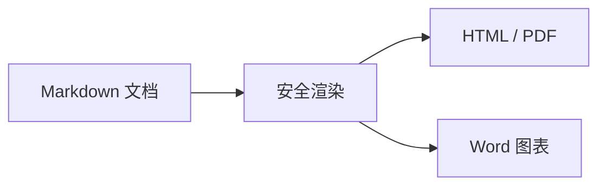

# Markdown 综合教程

本文件可编辑。每节包含说明、正确示例和预期效果；受限扩展明确标注。

## 标题

使用一到六个 # 表示标题层级。

# 一级标题
## 二级标题
### 三级标题
#### 四级标题
##### 五级标题
###### 六级标题

预期：按六种标题级别显示；可在大纲中导航。

## 段落与换行

空行分段；本应用的普通单换行也可见。

第一行
第二行

新段落。
行尾两个空格后硬换行。  
继续。

预期：分段及换行可见；保存保留原始分隔。

## 强调和行内代码

成对标记包裹文字。

**加粗**、*斜体*、~~删除线~~、`const 名称 = "Markumo"`。

预期：文字呈现对应样式。

## 多语言代码

围栏后写语言名。

```java
class Hello {
    public static void main(String[] args) {
        System.out.println("你好，世界 🌏");
    }
}
```

```typescript
const greeting: string = "Hello 中文"
console.log(greeting)
```

预期：语法高亮，真实换行保留；换行设置只改变显示。

## 列表与嵌套

使用缩进表达层级。

1. 阅读
2. 练习
   - 无序子项
     - 更深一层
   - 第二项

- 第一项
- 第二项

预期：有序及无序列表分级显示；实时编辑可增删条目。

## 任务列表

使用 GFM 任务标记。

- [x] 打开示例
- [ ] 修改文字
- [ ] 保存文件

预期：实时排版显示可操作的任务控件；Word 当前保留任务标记文字。

## 链接

可使用绝对、相对、自动及引用式链接。

[项目](https://github.com/yuanmahome/Markumo)

[同目录示例](01-基础语法.md)

[子目录文件](../02-Code/Hello.java)

<https://github.com/yuanmahome/Markumo>

[引用链接][project]

[project]: https://github.com/yuanmahome/Markumo

预期：链接可打开；Word 只为源文档目录或已授权工作区内的安全目标建立本地文件链接，越界目标保留文字并警告。

## 图片

图片支持行内和引用式目标。


![引用图片][picture]

[picture]: ../05-Media/example.svg

预期：显示图片并保持比例；本地读取受授权约束，Word 将 SVG 转换成 PNG。

## 表格

表头分隔线控制对齐，单元格可含行内格式。

| 项目 | 数量 | 状态 |
| :--- | ---: | :---: |
| **中文** | 12 | `ready` |
| *English* | 3 | [项目](https://github.com/yuanmahome/Markumo) |
| 换行<br>测试 | 2 | ~~完成~~ |

预期：表格显示对齐与行内样式；复杂 HTML 单元格及合并单元格不属于标准 Markdown 表格。

## 引用与嵌套引用

每层引用增加一个 >。

> 引用内容。
>
> > 嵌套引用。

预期：缩进引用；嵌套层级的 Word 排版可能简化。

## 分隔线

单独一行使用三个短横线。

段落之前。

---

段落之后。

预期：显示水平分隔线。

## 脚注

扩展语法；当前编辑器不保证交互式脚注。

正文带脚注[^note]。

[^note]: 这是脚注说明。

预期：源码可保存；Word 使用文末说明列表，其他预览可能保留原始标记。

## 数学公式

行内用单美元，独立公式用双美元。

行内 $E=mc^2$。

$$
\int_0^1 x^2 \, dx = \frac{1}{3}
$$

预期：预览使用 KaTeX；不支持的命令会提示；导出失败时保留源公式。

## HTML

仅允许安全标签和样式。

<details>
<summary>点击展开</summary>

这是补充内容。

</details>

<p><strong>安全 HTML</strong>，<mark>高亮</mark>。</p>

预期：预览显示安全 HTML；脚本和事件会被净化。Word 的 HTML 块按源码保留并报告限制。

## YAML Front Matter

仅在文档开头放置元信息。

```yaml
---
title: 示例
tags: [markdown, 中文]
---
```

预期：这是语法示例；当前没有专用元信息编辑器，不保证转换为导出属性。

## 目录

[TOC] 是扩展约定。

[TOC]

预期：当前 Word 导出生成标题链接列表；实时排版及 HTML 不保证生成目录。

## Callout

使用引用语法保留扩展提示。

> [!NOTE]
> 请先保存再导出。

预期：目前按引用显示，未提供完整的 Callout 专用编辑与导出语义。

## 转义与特殊字符

反斜杠转义 Markdown 标记。

\*不是斜体\*；\[不是链接\]；\# 不是标题。

中文 English，标点“”‘’——…；α β γ ∑ ≤ ≥ © ™ € →；emoji 🌏 🚀 ✅。

预期：标记按普通文字显示；emoji 外观取决于系统字体及 Office 字体支持。

## 多反引号代码

外层围栏比内容中的围栏更长。

````markdown
```js
console.log("嵌套围栏")
```
````

预期：完整显示内层三反引号，不会提前结束代码块。

## 长文档

长文档可配合大纲、全局搜索和分栏。

## 长文档练习

搜索这段文字，试试在另一分栏打开相同文件。

第 1 段：中文与 English 混排，保存和撤销不应改变原始编码、换行格式或 Markdown 标记。

第 2 段：中文与 English 混排，保存和撤销不应改变原始编码、换行格式或 Markdown 标记。

第 3 段：中文与 English 混排，保存和撤销不应改变原始编码、换行格式或 Markdown 标记。

第 4 段：中文与 English 混排，保存和撤销不应改变原始编码、换行格式或 Markdown 标记。

第 5 段：中文与 English 混排，保存和撤销不应改变原始编码、换行格式或 Markdown 标记。

第 6 段：中文与 English 混排，保存和撤销不应改变原始编码、换行格式或 Markdown 标记。

第 7 段：中文与 English 混排，保存和撤销不应改变原始编码、换行格式或 Markdown 标记。

第 8 段：中文与 English 混排，保存和撤销不应改变原始编码、换行格式或 Markdown 标记。

第 9 段：中文与 English 混排，保存和撤销不应改变原始编码、换行格式或 Markdown 标记。

第 10 段：中文与 English 混排，保存和撤销不应改变原始编码、换行格式或 Markdown 标记。

第 11 段：中文与 English 混排，保存和撤销不应改变原始编码、换行格式或 Markdown 标记。

第 12 段：中文与 English 混排，保存和撤销不应改变原始编码、换行格式或 Markdown 标记。

预期：可导航、搜索和编辑；超大导出受内存与输出体积预算限制。

## Mermaid

使用 mermaid 围栏；详细类型见同目录教程。



预期：显示流程图；选中图表可编辑源码，渲染失败会显示提示。
