# Mermaid 图表教程

使用项目锁定的 Mermaid 11.16.1。严格安全模式禁用脚本、外部引用及 HTML 标签配置；语法错误时显示提示。

## flowchart

编辑下面的 Mermaid 源码，再观察预览。图形比例随内容变化。

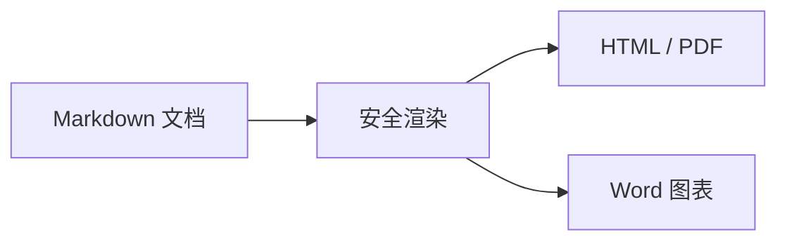

## sequenceDiagram

编辑下面的 Mermaid 源码，再观察预览。图形比例随内容变化。

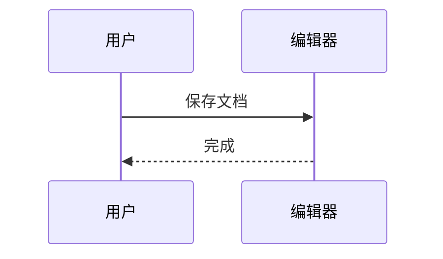

## classDiagram

编辑下面的 Mermaid 源码，再观察预览。图形比例随内容变化。

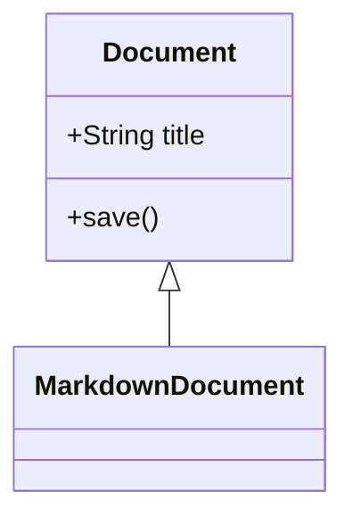

## stateDiagram-v2

编辑下面的 Mermaid 源码，再观察预览。图形比例随内容变化。

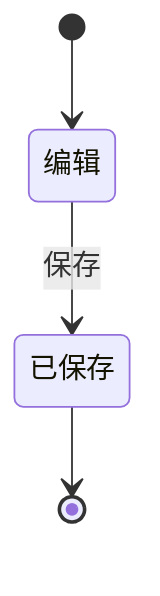

## erDiagram

编辑下面的 Mermaid 源码，再观察预览。图形比例随内容变化。

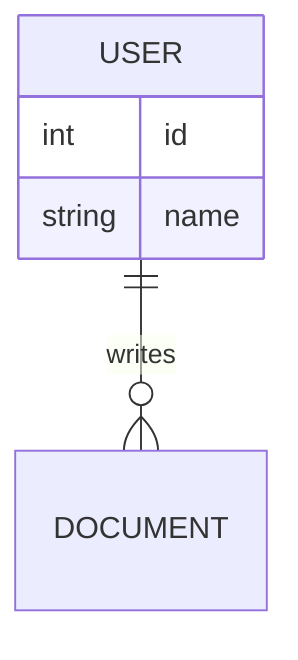

## gantt

编辑下面的 Mermaid 源码，再观察预览。图形比例随内容变化。

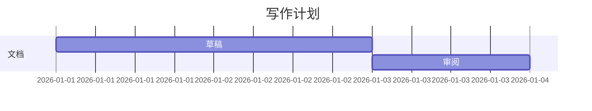

## gitGraph

编辑下面的 Mermaid 源码，再观察预览。图形比例随内容变化。

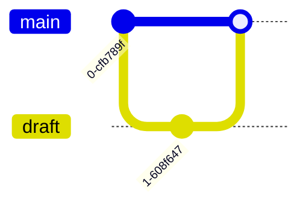

## pie

编辑下面的 Mermaid 源码，再观察预览。图形比例随内容变化。

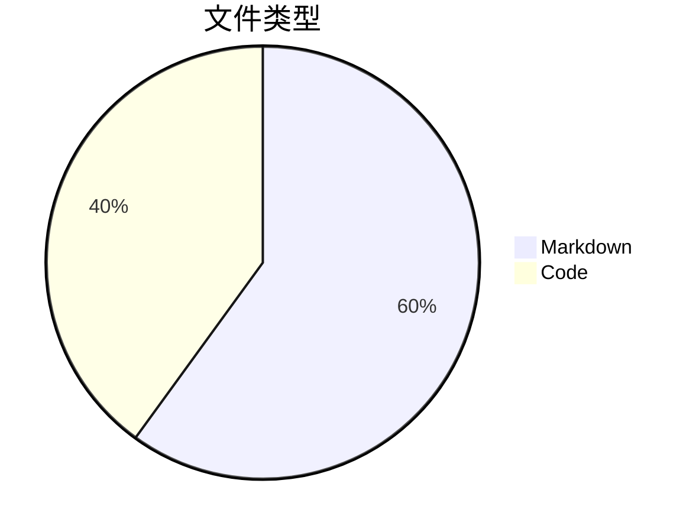

## mindmap

编辑下面的 Mermaid 源码，再观察预览。图形比例随内容变化。

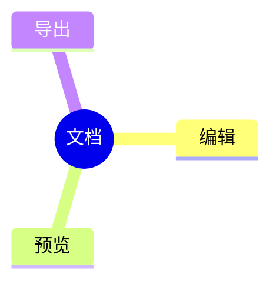

## timeline

编辑下面的 Mermaid 源码，再观察预览。图形比例随内容变化。

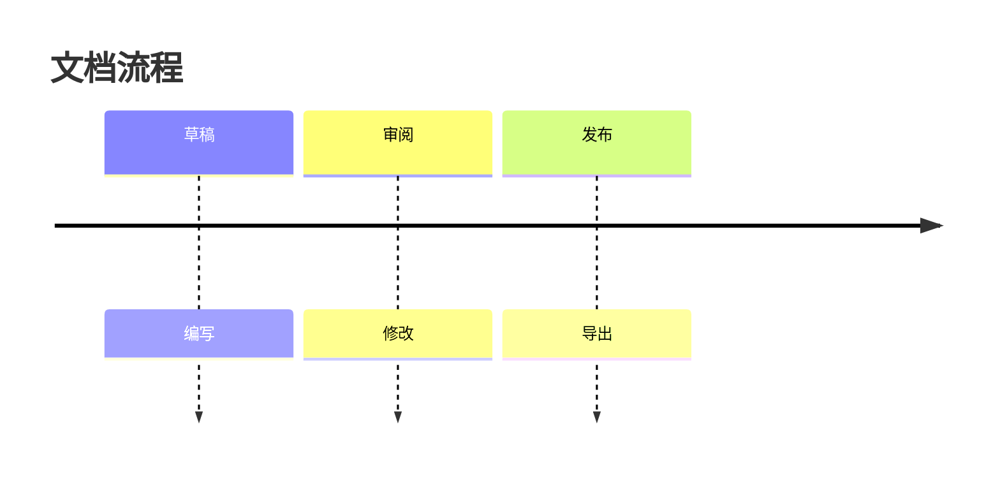

## xychart-beta

编辑下面的 Mermaid 源码，再观察预览。图形比例随内容变化。

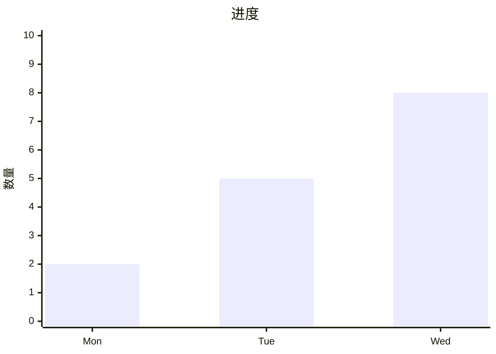
