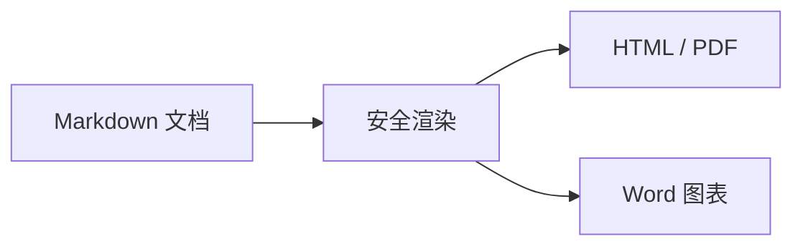
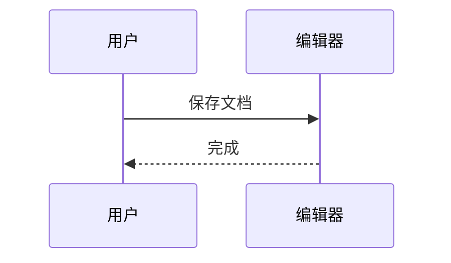
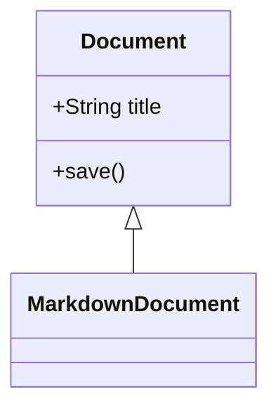

# 导出验收 Export acceptance

中文 English，Unicode α ≤ →，emoji 🌏。

## 列表与嵌套

1. 阅读
2. 练习
   - 无序子项
     - 更深一层
   - 第二项

- 第一项
- 第二项

## 任务列表

- [x] 打开示例
- [ ] 修改文字
- [ ] 保存文件

## 链接

[项目](https://github.com/yuanmahome/Markumo)

[同目录示例](01-基础语法.md)

[子目录文件](../02-Code/Hello.java)

<https://github.com/yuanmahome/Markumo>

[引用链接][project]

[project]: https://github.com/yuanmahome/Markumo

## 表格

| 项目 | 数量 | 状态 |
| :--- | ---: | :---: |
| **中文** | 12 | `ready` |
| *English* | 3 | [项目](https://github.com/yuanmahome/Markumo) |
| 换行<br>测试 | 2 | ~~完成~~ |

## 引用与嵌套引用

> 引用内容。
>
> > 嵌套引用。

## 脚注

正文带脚注[^note]。

[^note]: 这是脚注说明。

## 数学公式

行内 $E=mc^2$。

$$
\int_0^1 x^2 \, dx = \frac{1}{3}
$$

## HTML

<details>
<summary>点击展开</summary>

这是补充内容。

</details>

<p><strong>安全 HTML</strong>，<mark>高亮</mark>。</p>

## 多反引号代码

````markdown
```js
console.log("嵌套围栏")
```
````

## 长代码

```java
System.out.println("第 1 行 Hello 中文");
System.out.println("第 2 行 Hello 中文");
System.out.println("第 3 行 Hello 中文");
System.out.println("第 4 行 Hello 中文");
System.out.println("第 5 行 Hello 中文");
System.out.println("第 6 行 Hello 中文");
System.out.println("第 7 行 Hello 中文");
System.out.println("第 8 行 Hello 中文");
System.out.println("第 9 行 Hello 中文");
System.out.println("第 10 行 Hello 中文");
System.out.println("第 11 行 Hello 中文");
System.out.println("第 12 行 Hello 中文");
System.out.println("第 13 行 Hello 中文");
System.out.println("第 14 行 Hello 中文");
System.out.println("第 15 行 Hello 中文");
System.out.println("第 16 行 Hello 中文");
System.out.println("第 17 行 Hello 中文");
System.out.println("第 18 行 Hello 中文");
System.out.println("第 19 行 Hello 中文");
System.out.println("第 20 行 Hello 中文");
System.out.println("第 21 行 Hello 中文");
System.out.println("第 22 行 Hello 中文");
System.out.println("第 23 行 Hello 中文");
System.out.println("第 24 行 Hello 中文");
System.out.println("第 25 行 Hello 中文");
System.out.println("第 26 行 Hello 中文");
System.out.println("第 27 行 Hello 中文");
System.out.println("第 28 行 Hello 中文");
System.out.println("第 29 行 Hello 中文");
System.out.println("第 30 行 Hello 中文");
System.out.println("第 31 行 Hello 中文");
System.out.println("第 32 行 Hello 中文");
System.out.println("第 33 行 Hello 中文");
System.out.println("第 34 行 Hello 中文");
System.out.println("第 35 行 Hello 中文");
System.out.println("第 36 行 Hello 中文");
System.out.println("第 37 行 Hello 中文");
System.out.println("第 38 行 Hello 中文");
System.out.println("第 39 行 Hello 中文");
System.out.println("第 40 行 Hello 中文");
System.out.println("第 41 行 Hello 中文");
System.out.println("第 42 行 Hello 中文");
System.out.println("第 43 行 Hello 中文");
System.out.println("第 44 行 Hello 中文");
System.out.println("第 45 行 Hello 中文");
System.out.println("第 46 行 Hello 中文");
System.out.println("第 47 行 Hello 中文");
System.out.println("第 48 行 Hello 中文");
System.out.println("第 49 行 Hello 中文");
System.out.println("第 50 行 Hello 中文");
System.out.println("第 51 行 Hello 中文");
System.out.println("第 52 行 Hello 中文");
System.out.println("第 53 行 Hello 中文");
System.out.println("第 54 行 Hello 中文");
System.out.println("第 55 行 Hello 中文");
System.out.println("第 56 行 Hello 中文");
System.out.println("第 57 行 Hello 中文");
System.out.println("第 58 行 Hello 中文");
System.out.println("第 59 行 Hello 中文");
System.out.println("第 60 行 Hello 中文");
System.out.println("第 61 行 Hello 中文");
System.out.println("第 62 行 Hello 中文");
System.out.println("第 63 行 Hello 中文");
System.out.println("第 64 行 Hello 中文");
System.out.println("第 65 行 Hello 中文");
```

## 图片


## flowchart



## sequenceDiagram



## classDiagram



[超长链接](https://example.com/long-path/long-path/long-path/long-path/long-path/long-path/long-path/long-path/long-path/long-path/long-path/long-path/long-path/long-path/long-path/long-path/long-path/long-path/long-path/long-path/long-path/long-path/long-path/long-path/long-path/)
