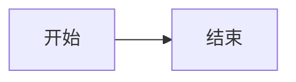

ATX 与 Setext
=============

##   ATX 标题  ##

LOCAL_EDIT_TARGET 中文 😀 é  保留两个空格；__加粗__、_斜体_、~~删除~~、\*转义\*、&amp; 实体。

原始链接 [引用标签][ref] 与 <https://example.com/a%20b>，裸链接 https://example.com/q%20x。

[ref]: <https://example.com/a%20b> '保留单引号标题'

+ 第一项 __原始标记__
  + 嵌套项 NESTED_EDIT_TARGET

    > 引用内仍有 _斜体_。

    ````javascript extra="kept"
    const nested = `value`;
    ```
    ````

  + 

3) 有序第一项
4) 有序第二项

- [X] 完成任务
- [ ] 未完成任务

> > 两层引用
> >
> > QUOTE_EDIT_TARGET __原样保留__。

> [!TIP] 自定义标题
> Callout 保留。

| 左对齐 | 居中 | 右对齐 |
| :----- | :--: | -----: |
| CELL_EDIT_TARGET | `a\|b` | [链接][ref] |

`````typescript {#sample .numberLines}
CODE_EDIT_TARGET 中文
```` 内部围栏
`````

    缩进代码第一行
    缩进代码第二行


行内 HTML <span data-custom="a &amp; b">原始 __文本__</span> 和 $x^2+\\alpha$。

<details data-extra='keep'>
<summary>原生 HTML</summary>

**内部写法保留**
</details>

$$
\begin{aligned}
a &= b \\
c &= \alpha
\end{aligned}
$$



脚注引用[^note]。

[^note]: 第一行脚注。
    第二行脚注 __保留写法__。

[TOC]

:::custom-extension {data="opaque"}
无法识别的扩展保持源码。
:::

END_SENTINEL 不应被局部编辑修改。
